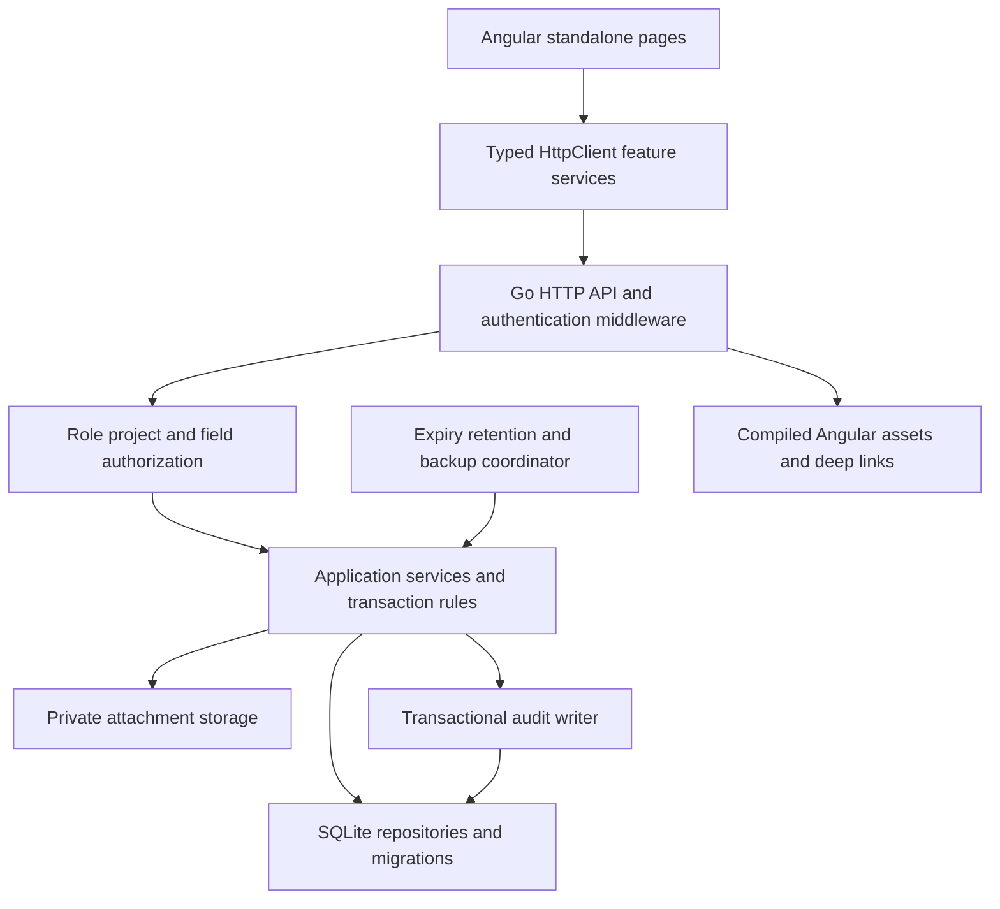

# Design: BuildEstate — Construction And Property Management

## Overview and authority

BuildEstate is a single-company internal application connecting construction delivery, procurement, contractor work, project costs, property sales and collections. Release 1 implements the 36 pages in `requirements.md`, the seven connected acceptance journeys and Sale confirmation and handover. This document is a build contract, not evidence that the application or its tests already exist.

Authority is the approved `requirements.md`, refined by `.nexgile/greenfield/answers.md` and the supplied `docs/input/Greenfield-Angular-Go-SQLite-Requirements.md`. The brief's settled decisions govern approval separation, recovery, precision, cancellation terms, sale confirmation, retention and local operation. Requirement references below use the approved criterion IDs.

The implementation uses Angular standalone components with strict TypeScript, a Go HTTP service and persistent SQLite. Local execution uses no Docker. Go serves the compiled frontend and `/api/v1` together for built-application execution. Development uses Angular's development server and a same-origin API proxy. Delivery is local only.

## Architecture

### Dependency and module boundaries

- Frontend: Angular router, HttpClient, reactive forms, signals for transient UI state, RxJS for request orchestration, Angular CDK for accessible dialogs/overlays, and one locally packaged Lucide icon family. Use self-hosted IBM Plex Sans. Do not introduce a second component theme.
- Backend: standard Go HTTP routing, explicit transport/application/repository layers, `database/sql`, `modernc.org/sqlite` for a pure-Go Windows-compatible SQLite driver, `golang.org/x/crypto/argon2` for password hashing. No native C toolchain is required by the chosen driver. Pin supported compatible versions at implementation time, including the driver's supported SQLite version.
- Tests: Go test and fuzz/property tests, Angular TestBed with Vitest in run mode, fast-check for TypeScript properties, and Playwright against the real application. Pin direct dependencies, Node/Angular/Go versions, `package-lock.json`, `go.mod` and `go.sum`; record tool versions in README.
- The transport layer decodes, bounds and validates requests; the application layer owns policy, transactions and lifecycles; repositories accept an existing transaction and cannot commit independently. A service's audit and idempotency writes use the same transaction as its business writes.
- Reports use the same authorized repository predicates and canonical calculation functions as detail screens. The frontend never independently decides stock availability, invoice balances, cost recognition or unit ownership.

### Planned repository boundaries

| Path | Responsibility and integration contract |
| --- | --- |
| `package.json`, `package-lock.json`, `scripts/` | Root orchestration scripts, installation, local process management and complete test command |
| `frontend/` | Angular workspace; its package scripts run its own configuration from the package directory |
| `frontend/src/app/core/` | Session restoration, guards, CSRF/error interceptors, permission-aware shell, project context and typed API client |
| `frontend/src/app/shared/`, `frontend/src/styles/`, `frontend/public/fonts/` | Shared accessible controls, design tokens, IBM Plex Sans files and license |
| `frontend/src/app/features/<area>/` | Lazy feature routes, API services, page components, each page's own styles and colocated tests |
| `frontend/src/app/app.routes.ts` | Central route composition owned by the foundation; imports stable feature route exports |
| `backend/cmd/server/`, `backend/cmd/manage/` | HTTP process and operator commands for migrate, bootstrap, seed, backup and restore validation |
| `backend/internal/platform/` | Configuration, database connections, transactions, errors, logging, clock and private file store |
| `backend/internal/access/`, `backend/internal/audit/` | Authorization, sessions, credentials, users and shared audit writer |
| `backend/internal/{projects,sitework,procurement,inventory,contractors,finance,sales,documents,reporting,settings}/` | Domain services, HTTP handlers, repositories and integration tests |
| `backend/internal/httpapi/` | Shared middleware and central mounting of feature handlers; no domain calculations |
| `backend/migrations/` | Ordered SQL migrations; one numbering owner allocates ranges before parallel work |
| `docs/openapi.yaml`, `docs/api/` | Composed OpenAPI 3.1 contract with area-owned schema/path fragments |
| `docs/operations/`, `docs/evidence/` | Local operating instructions, metric formulas, restore procedures and acceptance matrix/results |
| `tests/integration/`, `tests/capacity/`, `e2e/` | Self-contained cross-stack tests, capacity harness and saved browser journeys |

Feature route exports are `AUTH_ROUTES`, `PROJECTS_ROUTES`, `SITEWORK_ROUTES`, `PROCUREMENT_ROUTES`, `CONTRACTORS_ROUTES`, `FINANCE_ROUTES`, `SALES_ROUTES`, `DOCUMENTS_ROUTES`, `ADMINISTRATION_ROUTES` and `REPORTING_ROUTES`. The foundation mounts their stable paths before feature implementation; incomplete features are not described as delivered. Each feature registers handlers through `RegisterRoutes(mux, dependencies)`, with named interfaces for policy, clock, transactions, audit and documents. Shared manifests, contract composition and route mounting have a single owner; subsequent changes list those shared files explicitly. Feature agents own their page styles and domain tests, not the global stylesheet.

## Build and run

Install: npm install && npm run install:backend
Test: npm test
Run locally: yes
Dev: npm run dev
Port variable: PORT
Health path: /api/v1/health/ready
Devices: both
Deploy: none

### Command implementation contract

All commands run from the repository root in cmd.exe or PowerShell, without shell-specific environment assignments. Root Node orchestration scripts spawn commands with argument arrays and explicit working directories; they fail on any child failure and propagate signals. The root package declares `frontend` as an npm workspace.

| Command | Required behavior |
| --- | --- |
| `npm run install:backend` | Run `go mod download` with working directory `backend` |
| `npm run migrate` | Run ordered migrations against the configured persistent SQLite location; record checksums and reject changed applied migrations |
| `npm run bootstrap` | Operator command prompts privately for first Administrator email/password and company recovery contact instructions; accepts credentials via protected standard input, never arguments or logs; creates the first Administrator only when no staff account exists |
| `npm run seed:development` | Explicitly populate an empty, development-marked database with related demonstration business records; require a bootstrapped operator account and confirmed demonstration currency; never seed credentials or overwrite operational records; repeat execution recognizes fixture IDs |
| `npm run dev` | Load configuration, migrate non-destructively, process overdue reservations, then launch Go and Angular on loopback; never seed business data or credentials |
| `npm run build` | Check strict frontend types, build Angular, and build Go executables; copy frontend build to the configured static asset directory |
| `npm run start` | Run the built Go server, serving Angular and API on the configured port after migrations and startup checks; never seed |
| `npm test` | Run frontend unit tests once, Go tests, contract validation and isolated real-backend integration/browser acceptance tests; start/stop every required process and temporary SQLite/file store; return nonzero on failure and exit |
| `npm test --workspace frontend -- <test-path-fragment>` | Run only matching frontend tests once with frontend's own Vitest/TestBed configuration |
| `npm run test:backend -- <package>` | Run `go test` for that package from `backend`; no existing server or database needed |
| `npm run test:integration` | Isolated real migrations, HTTP and browser workflows with dynamically allocated ports and runtime-generated staff credentials |
| `npm run test:capacity` | Explicit resource-intensive year-1/year-3 performance and storage campaign, not silently included in routine unit runs |
| `npm run backup` / `npm run restore:check` | Consistent backup or disposable restore validation through the local operator protocol; never replace an operational database |

The development runner reads `PORT` itself, uses an available port when it is absent for manual runs, binds Angular to `127.0.0.1`, and obtains a separate free loopback port for Go. It generates Angular's proxy configuration for `/api/v1` to that Go port. Child startup retries only port-allocation races. Health is reachable through Angular's port. The runner shuts down both children and reports readiness failure rather than leaving a half-started app. Built Go binds `127.0.0.1` and reads `PORT` itself. No fixed port or app environment variable is required by a test command.

`.env.example` defines non-secret local defaults for `APP_MODE=development`, `DATA_DIR=./var/local`, `SQLITE_PATH=./var/local/buildestate.sqlite`, `ATTACHMENTS_DIR=./var/local/attachments`, `BACKUP_DIR=./var/backups`, `STATIC_DIR=./frontend/dist/buildestate/browser`, and `COOKIE_SECURE=false`. The loader resolves paths relative to the app root, rejects incompatible directories, and uses `.env` if present, otherwise these documented defaults. Protected backup storage outside the application's data directory must be chosen and checked before operational use; the local example directory is not proof of separate protected storage. Keep `.env`, mutable local data, generated proxies, binaries and test artifacts out of source control.

README includes cmd.exe and PowerShell examples for every command above, prerequisites, first bootstrap, administrator-assisted account setup, recovery, and serving the local production build. Bootstrapping is explicit rather than a hidden startup side effect. Test fixtures create seven roles plus additional independent approvers with random credentials in disposable databases; there are no fixed seeded login credentials. Integration tests and browser harnesses own those credentials only for their run. Saved `e2e/` journeys use `@playwright/test`; ordinary frontend and Go unit discovery excludes that directory. Keep `e2e/.gitkeep` initially. Automated integration/browser suites start their own app and never assume the preview is running.

## Authentication and authorization

### Session and password design

1. Normalize email with trimming and case-folding for lookup; preserve a display form. Verify an Argon2id encoded hash using a per-password cryptographic salt. Initial parameters are 64 MiB memory, three iterations and parallelism one; benchmark under the specified concurrent sign-in load before accepting them. Password length is 12–128 Unicode characters with a bounded encoded request length; allow paste, spaces and password managers.
2. Login uses equal-shaped invalid/inactive/unknown-account responses and a dummy Argon2id verification for unknown accounts. Persistent rate-limit buckets use keyed hashes of normalized identifiers and origin addresses, never raw passwords. Limits: five failed attempts per identifier per 15 minutes and 30 per origin per 15 minutes; token reset attempts use the same bounds by token digest and origin. Recovery issuance is limited to five per target per hour and 30 per issuing Administrator per hour. Counters and generic responses do not reveal account existence. Return 429 with `Retry-After`.
3. Generate 32 random bytes for a session token; store only SHA-256 token digest, user ID, credential/access revision, creation time, last interaction, idle expiry, absolute expiry and revocation time. Rotate on every successful login, revoking any presented prior session. Set cookie `buildestate_session`, path `/`, HttpOnly, SameSite=Lax, host-only; Secure is required for HTTPS mode and disabled only for documented local HTTP use. Never put bearer credentials in URLs or persistent browser storage.
4. `GET /auth/csrf` returns a short-lived signed double-submit nonce and sets a readable host-only SameSite cookie `buildestate_csrf`. Every mutating browser request, including login/reset, sends `X-CSRF-Token`. Verify the signature, constant-time cookie/header equality and exact same-origin `Origin`; do not trust forwarded host headers by default. Rotate and session-bind the CSRF value at login and return the new value. Server secrets are generated privately in the data directory at first initialization or supplied externally, never committed.
5. Idle expiry is 30 minutes; absolute expiry is 12 hours. Authorized user interactions refresh idle expiry but never absolute expiry. Background status/dashboard polling and `auth/me` do not refresh idle expiry. A middleware clock is injectable for expiry tests. On expiry, return 401 `SESSION_EXPIRED`, clear authenticated stores and display the branded reauthentication state. Never replay a queued mutation automatically.
6. Every protected operation looks up active account, session validity and current access revision. Role/assignment/deactivation/password changes revoke sessions in their transaction. Mutations recheck access inside the write transaction, avoiding a permission-change race between middleware and commit. Downloads check authorization before opening content; streaming responses remain cancellable.
7. Setup uses an Administrator-issued, single-use 24-hour token. Recovery uses a 30-minute token issued only by an Administrator after identity verification. Persist digests, kind, expiry, issuer, consumed/revoked times; revoke earlier outstanding tokens of the same purpose on replacement. Reset links place the opaque token in the login URL fragment; the account shell extracts it into transient memory and immediately removes it from the address bar/history. Use `Referrer-Policy: no-referrer`, no third-party assets, and no request-body logging. The issue response discloses the new link once to the Administrator for the trusted channel; it is never subsequently retrievable.
8. Recovery guidance shows the configured company Administrator contact/instructions. The operator verifies identity by an established in-person or known-number conversation and delivers the one-time link privately. Setup-required accounts cannot access domain APIs; reset completion and logout are the only permitted mutations. Successful setup/change/reset atomically writes the new hash, consumes applicable tokens, revokes all sessions and adds safe audit evidence; the person signs in afresh.
9. Bootstrap creates only the first active Administrator; staff creation uses setup links. The final active Administrator guard runs inside the serialized transaction for role changes and deactivation, including concurrent attempts. Operators establish a second Administrator through Users and access for independent approvals.

### Policy matrix

Every row requires current project authorization and, where relevant, assigned record ownership. Administrator has company-wide project scope but must obey all independent-review and lifecycle rules. Other roles have explicit project assignments. Project Managers can create a new project and are assigned to it atomically; assigning other staff remains an Administrator action. A Sales Executive sees only sales records assigned to them, their linked customer balances, and available units in assigned projects. Shared catalogs expose operational fields only; their history is scoped.

| Area / actions | Administrator | Project Manager | Site Engineer | Procurement Officer | Finance Officer | Sales Executive | Management Viewer |
| --- | --- | --- | --- | --- | --- | --- | --- |
| Dashboard/reports | All permitted summaries | Progress, overdue, inspections, budget summary | Site progress/issues/quantity summaries | Orders, quantities, low stock | All financial and reconciliation reports | Assigned sales and collection summaries | Authorized project summaries only |
| Projects/sites/plan | Manage | Manage | Read operational plan; task progress only | Read project/site selectors | Read project/site and costs | Read project/site and sales context | Report summaries only |
| Site logs/inspections/issues | Manage/review independently | Read/review; manage issues | Create/update own logs/checks; assigned issue actions | None | Evidence attached to permitted costs only | Unit inspection summary only when permitted | Reports only |
| Materials/suppliers/inventory | Manage | Read, create purchase orders | Material selector, site balances, issue/return | Manage catalog, receipts, transfers, issue/return | Read costing/source evidence | None | Report summaries only |
| Purchase order approval | Independent approval | Procurement Officer submissions | None | Submit, not approve | Project Manager submissions | None | None |
| Stock adjustments | Independently approve | Read | None | Propose | Read evidence | None | None |
| Contractors/work orders | Manage and independent approval | Manage and submit | Assigned completion evidence without prices | Permitted procurement references | Read and independently approve | None | Report summaries only |
| Budgets/expenses | Manage and independent approval | Budget read; expense submission | Own expense submission/evidence, without project totals | Own expense submission/evidence | Manage; independent expense review | Own expense submission/evidence | Summary reports only |
| Invoices/payments/allocations | Manage | Assigned approved-cost/payable summaries only | None | Supplier/order receipt references, no customer finances | Manage | Assigned customer collection projections, not finance mutation routes | Summary reports only |
| Properties/leads/customers/visits/bookings | Manage | Unit construction/checklist actions | Assigned unit inspection evidence | None | Payment checks and financial evidence | Manage assigned sales work | Report summaries only |
| Cancellation terms/refunds | Independently approve | None | None | None | Propose; record approved refund | Request cancellation | None |
| Sale confirmation | Independent of booking creator | None | None | None | Independent of booking creator | Record agreement/milestone, not confirm | None |
| Handover | Same required evidence | Checklist completion | None | None | Payment clearance | Record date after prerequisites | None |
| Users/settings/operator status | Manage | None | None | None | None | None | None |
| Audit | Search | Assigned approval trails | None | None | Relevant financial trails | None | None |
| Documents | Parent-policy access | Parent-policy access | Parent-policy access | Parent-policy access | Parent-policy access | Parent-policy access | Only evidence explicitly exposed by authorized reports |

Role-forbidden collection/action routes return 403; unauthenticated routes return 401. An inaccessible individual ID returns the same 404 as an absent ID, including attachments, linked customers and nested resources. List counts, filters, search suggestions, aggregates and exports apply authorization before pagination/aggregation. Field-level DTO projections omit confidential properties, rather than sending them as hidden frontend data. Management Viewer's drill-downs stay inside reports. Route metadata identifies required capabilities, but Go is the security boundary.

Server capability names use `area.action`, such as `projects.create`, `plan.manage`, `tasks.progress`, `siteLogs.review`, `purchaseOrders.approve`, `stock.adjustments.approve`, `invoices.post`, `bookings.confirmSale`, `users.manage`. A closed capability registry maps the table above to handlers and page metadata. Resource responses expose `allowedActions` computed from current state, creator and scope. They guide controls but are never accepted back as authority. Administrator permissions do not bypass creator separation.

## Data models and persistence

### Common representations

- IDs are server-generated UUID strings. Every mutable entity has `id`, `createdAt`, `updatedAt`, `createdBy`, `version`; project-owned records additionally have `projectId`. SQLite timestamps are UTC RFC3339 strings with fixed precision; API timestamps are RFC3339 UTC. Date-only fields use `YYYY-MM-DD` and are never shifted by timezone conversion.
- Currency is one configured ISO currency plus stored minor-unit precision. JSON exact integers use decimal strings, including `amountMinor`, to avoid JavaScript precision loss. SQLite uses checked 64-bit integers; calculations use checked integers or Go big integers before bounded persistence. Quantities use integer thousandths internally and decimal strings with at most three places externally. Unit prices use integer ten-thousandths of major currency units and strings with at most four places. Percentages/weights use integer basis points internally. Do not use binary floating point for financial calculations.
- Missing optional values are explicit JSON `null`; arrays are empty rather than null. Create/update requests reject unknown fields. An update is a full editable-field replacement using `PUT` and `version`; omitted required fields are errors. Immutable metadata, computed fields and lifecycle status cannot be directly edited.
- Foreign keys use restrict behavior for retained business records. Archive actions replace deletion. Append-only financial/stock/audit tables expose no editable history. Safe contact anonymization is an explicit reviewed operation, not deletion of relationships.

### Relational model

| Tables | Important columns, relationships and constraints |
| --- | --- |
| `users`, `roles`, `user_projects` | Unique normalized email, role FK, account status, hash, access revision, required setup flag; composite unique user/project assignment; role codes are fixed server values |
| `sessions`, `password_tokens`, `rate_limit_buckets` | Unique token digests, user, expiry/revocation/consumption and indexed deadlines; hashed limiter subject/window keys |
| `projects`, `sites`, `project_overrides` | Unique project code; site code unique within project; date-range checks; manager FK; archived flag; validated scoped defaults |
| `milestones`, `tasks`, `plan_revisions` | Project and responsible user FKs, milestone relation, planned dates, status, completion and positive weights; a plan revision holds a validated active weight set |
| `site_logs`, `site_log_workers`, `review_decisions` | Project/site/date, entered work/weather/blockers/notes, nonnegative worker counts, lifecycle and immutable review decisions |
| `inspections`, `inspection_items`, `issues`, `issue_events` | Project, optional milestone/unit, checklist snapshot/results, corrective issue relation; owner/priority/date and reasoned resolution history |
| `materials`, `material_site_minimums`, `suppliers` | Unique material code, immutable unit once referenced, minimum quantities; supplier details and active status |
| `purchase_orders`, `purchase_order_lines`, `purchase_order_revisions` | Project/site/supplier, submitter role snapshot, approved revision, material/unit, ordered quantity, price, promised date; amendment snapshots |
| `goods_receipts`, `goods_receipt_lines`, `stock_transactions`, `stock_entries`, `stock_adjustments` | Receipt lines reference approved order lines; unique source transaction/line/effect; signed integer quantities, site/material/unit; transfer pair shares transaction; adjustment proposal and independent decision |
| `contractors`, `contractor_projects`, `work_orders`, `work_order_milestones`, `work_order_revisions` | Project membership, scope, agreed amounts, responsible manager, dates, progress/evidence and approved revision |
| `budgets`, `budget_revisions`, `budget_lines`, `cost_categories` | One current approved budget revision per project, historical versions, category and exact amount |
| `expenses`, `cost_sources`, `cost_recognitions` | One source identity for a cost; expense/bill links share it; immutable approved recognition and reversal entries reference project/category and originating commitment line |
| `invoices`, `invoice_lines`, `invoice_sources`, `duplicate_reviews` | Unique invoice number, payable/receivable, project, counterparty kind/ID, amounts, tax, due date, status; work/order/receipt evidence, reviewed supplier-reference warnings |
| `payments`, `allocations`, `financial_reversals`, `refund_proposals` | Direction, method/reference/date, project/counterparty/booking, exact amount; allocations point to posted invoice/payment; reversal entries retain originals; approved refund ceiling and payment links |
| `properties`, `property_price_history`, `property_images` | Unique project/unit code, site/block/floor, type, area, asking price, construction status and independent availability; images reference authorized documents |
| `leads`, `lead_activities`, `site_visits`, `customers` | Assigned salesperson/project, contact/preferences/follow-up, immutable activities; visits retain scheduled/actual/outcome; customer source lead FK |
| `reservations`, `bookings`, `unit_claims` | Reservation expiry; booking customer/salesperson/agreement/status; `unit_claims.property_id` primary key guards one reservation or booking, with exclusive nullable reservation/booking FKs |
| `installments`, `cancellation_terms`, `cancellation_bands`, `cancellations` | Explicit schedule, approved immutable terms revision, nonoverlapping effective-date bands, fixed or percentage deduction, request and approval histories |
| `sale_milestones`, `payment_verifications`, `handover_items`, `handovers` | Agreement document/date, required payments, verifier/receipt allocations, independent confirmer; checklist evidence and distinct Finance clearance/date |
| `documents`, `document_links`, `upload_batches` | Random private key, original display filename, verified MIME, byte count, SHA-256 content digest, project and typed entity FK linkage, quarantine/active/archive state |
| `audit_events`, `idempotency_records` | Immutable safe changes and request metadata; unique principal/operation/key with request digest and authorized result reference |
| `company_settings`, `reference_values`, `policy_acknowledgments`, `privacy_requests`, `retention_holds`, `retention_reviews` | Single company, currency lock, timezone confirmation, references, operating policy metadata and reasoned stewardship approvals |
| `reconciliations`, `reconciliation_lines`, `reconciliation_reviews`, `report_snapshots`, `backup_runs` | Persisted source snapshot and discrepancy lines, independent Project Manager/Finance signoffs, export metadata/holds, backup manifest/status |

Typed document links are implemented through a validated parent registry plus concrete FK link tables per supported entity, not an unchecked arbitrary entity ID. All links must match the document project and inherit the most restrictive parent classification. Every table is created by versioned migrations, including indexes and guards; lifecycle values have database checks. A trigger prevents updates/deletes to immutable ledger/audit rows outside dedicated maintenance operations; maintenance itself has no ordinary application route.

### SQLite connection and concurrency policy

Use WAL on a local filesystem, `foreign_keys=ON` on every connection, `busy_timeout=5000`, and `synchronous=FULL`. Configure one serialized writer connection and a bounded pool of four read connections. Use short `BEGIN IMMEDIATE` transactions for stateful writes. Never hash passwords, upload files or render exports while holding a write transaction. A transaction's read/check/write sequence includes account revision, entity versions, state checks, policy, balance/claim checks, writes, audit and idempotency result. Bounded contention failures return 503 `STORAGE_BUSY`; the UI preserves input and requires deliberate retry using the same key.

Indexes cover `(project_id,status,updated_at,id)`, project/date and due-date queries, staff assignments, supplier/order and receipt-line links, stock `(site_id,material_id,id)`, invoice/payment allocation foreign keys, normalized contact search, property availability, reservation expiry, document links, audit `(project_id,occurred_at,id)` and actor/time, session/token digest and expiry. Unique indexes enforce project/material codes, project/unit codes, invoice numbers, cost source recognition identity and source stock effects. The single row per property in `unit_claims` is the database guard across reservation and booking tables, including sold bookings. List scans and reports use query-plan tests at target volumes, not just small fixtures.

### Lifecycle and transaction rules

| Workflow | State transitions and atomic boundary |
| --- | --- |
| Project | draft → active ↔ on-hold → completed → archived; archive retains references; reopening completed requires manager reason |
| Plan | planned → in-progress → completed; cancellation needs explicit rebalanced active revision if weighted; completion stays within 0–100 |
| Site log | draft → submitted → approved or returned; returned → submitted after correction; content edits limited to own draft/returned records |
| Inspection/issue | inspection draft → submitted → completed with no unlinked failed item; issue open → in-progress → resolved → reopened, with reason/evidence and history |
| Purchase order | draft → submitted → approved → part-received → received; authorized cancellation preserves receipts; approved amendments are new reviewed revisions and cannot reduce ordered quantity below net received |
| Receipt | draft → posted → reversed; posting checks every remaining quantity, inserts all ledger effects and changes order status in one transaction; reversal checks available stock before compensation |
| Stock | issue/return/transfer append posted entries; return quantity cannot exceed the unreversed original issue; transfer checks both sites and commits both sides; independent approved adjustment posts once |
| Work order | draft → submitted → approved → in-progress → completed; cancellation preserves recognition and evidence; amount changes require a fresh independent approval revision |
| Budget/expense | budget draft → approved → revised history; expense submitted → approved or rejected; corrected rejected expense creates a new version/submission; creator cannot review |
| Invoice/payment | draft → posted → reversed; immutable posted amounts; reversals append linked effects and reverse affected allocations atomically, preserving original rows |
| Lead/visit/customer | lead new/contacted/qualified/visit/booked/lost with recorded stage events; visit scheduled → completed/cancelled; customer active → archived without removing bookings |
| Reservation/unit | available → reserved on claim insertion; active reservation → converted/expired/cancelled; conversion changes the same claim to a booking; expiry removes only its own still-active claim; manually unavailable only without claim |
| Booking | draft → active → cancellation-requested → cancelled; a declined request returns active with reason; requested cancellation retains ownership until approval; sold remains a separate confirmation on the active booking |
| Sale/handover | sale requires active booking, signed agreement, date and current Finance payment verification; independent Finance/Administrator changes booked → sold atomically; separate checklist and current Finance clearance precede Sales handover date |

Actions absent from the matrix are denied. Approved return/rejection actions require reasons. Pending review queues are filtered by eligibility; absence of a second eligible person leaves the request pending. A submitter's role at submission determines purchase-order routing; current permissions still determine reviewer eligibility. Changes to approval-sensitive fields invalidate earlier approval and payment verification. Reversing evidence used by a confirmed sale or handover is blocked until an independently reviewed correction/cancellation resolves the dependent confirmation; it cannot silently leave invalid sold evidence.

Idempotency uses a caller-generated UUID `Idempotency-Key` for all state-changing requests, including create, review, posting and acquisition. Store principal, operation, key, canonical request digest and result reference in the business transaction. Reuse with the same digest returns the recorded status/result after current authorization; changed payload yields 409 `IDEMPOTENCY_MISMATCH`. Durable source uniqueness also guards ledger/financial effects. Do not prune keys while their irreversible source record remains retained. A network timeout leaves a visible uncertain-result state; an explicit retry reuses the key, while an edited submission gets a new key. No browser interceptor automatically retries writes.

Reservation jobs run at startup before readiness and every 60 seconds, using an injected UTC clock. Every acquisition also expires the relevant stale reservation within its write transaction. Comparison is `expiresAt <= now`; a converted reservation cannot release a booked/sold unit. A booking draft holds no claim. Activation either claims an available unit or converts that customer's active reservation; the transaction rechecks approved terms and installment sum. Concurrent claim failure returns 409 with only the authorized unit's current availability.

### Exact calculations and reporting semantics

- Progress = sum of active milestone completion × weight / 100; weights total exactly 100 and are positive. Round display to two decimals half-up, retaining exact basis-point inputs. No valid plan returns `progressPercent: null` with `progressState: unconfigured`. Site-log approval adds activity, not invented milestone progress.
- For quantity thousandths `q`, unit-price ten-thousandths `p`, and currency precision `d`, line minor amount = half-up rounding of `q × p × 10^d / 10^7`. Sum rounded lines plus staff-entered nonnegative tax. For a two-decimal currency, quantity 1.250 at price 12.3456 gives 15.43, not a floating-point approximation. Validate totals within signed 64-bit storage bounds.
- A `cost_source` is the shared economic source for expense and payable bill. Approval/posting creates only one active recognition per source amount; a linked bill confirms the existing recognition rather than adding another. Partial recognition references a commitment line and amount, bounded by approved values or an approved amendment. Mismatched linked amounts require reviewed correction, not silent selection of one value.
- Approved actual cost = sum of valid recognition amounts less recognition reversals. Remaining commitment = sum of approved purchase/work-order line amounts not yet recognized, excluding cancelled remainder. Budget variance = approved budget − approved actual cost − remaining commitment. Manual payments are cash, never an additional cost recognition.
- Invoice outstanding = valid posted total − valid allocations. Payment unallocated = valid posted cash − valid allocations − linked valid refunds that consume that cash. Receivable and payable directions must agree with incoming/outgoing allocations and the same project and counterparty. Reversal recomputes from entries, not a mutable balance field. Booking collections use attributed valid receipt allocations; an unapplied customer receipt is not evidence of payment for a particular booking.
- Booking installment amounts sum exactly to negotiated agreed price. Historical agreements and installments never change with asking-price history. Installment invoicing consumes each installment once; invoice tax is explicit and separate, and invoices display any difference from the agreed installment principal rather than altering the schedule.
- Cancellation chooses the recorded band's inclusive effective start and exclusive end by cancellation request date in company time. Bands must not overlap or leave the booking's permitted cancellation period uncovered. A deduction is either fixed minor units or a basis-point percentage of agreed price, rounded half-up. Let `C` be valid original collections net of receipt reversals, `D` the recorded deduction, and `F` valid separate refunds paid: remaining refundable = min(max(0, C − F), max(0, C − D − F)). Cancellation itself changes neither `C` nor `F`. Approval freezes terms version, calculation inputs and cap; later receipt reversals trigger revalidation before refund payment.
- Overdue invoice/instalment requires date before today's company date and positive outstanding; overdue task requires an incomplete, uncancelled task; overdue lead follow-up excludes booked/lost stages. No amount changes just because time passes.
- Dashboard query uses a committed read snapshot, server generation timestamp and no more than 60-second scoped caching; safest initial implementation queries live and refreshes visible dashboards every 60 seconds. Cache keys, if introduced, include user/access revision, authorized scope and filters. A scope change invalidates them immediately.
- Every metric returns `metricKey`, `value`, `unit`, `formula`, `sourceReport`, `sourceFilters`, `generatedAt`. Metrics are project status counts, weighted physical progress, approved costs, commitments, variance, overdue tasks/issues/invoices/follow-ups, low-stock counts, available/reserved/booked/sold unit counts, negotiated active booking amounts, posted invoices and net collected cash. Finance metrics are omitted from unauthorized DTOs. Stock initially has quantity values only.
- Reports show filter values and generation time and expose reconciled source rows. Reconciliation snapshots capture matched order/receipt/work evidence, source-cost links, missing/duplicate discrepancies and totals. Project Manager and Finance Officer sign off independently; subsequent changes do not rewrite the saved snapshot. Support documents and audit events remain linked.

## Components and shared state contracts

The Angular session store has `status: restoring | anonymous | setupRequired | authenticated`, `user: null | {id,displayName,email,role}`, `projectIds`, `capabilities`, `landingPath`, `csrfToken`, `idleExpiresAt` and `absoluteExpiresAt`. It exists in memory only. Restoration completes before protected route activation. Root `/` resolves to `/login` or the server's landing path. Login return paths must parse as a same-origin relative path beginning with a single slash, contain no backslash/control characters/embedded scheme, and match an authorized application route; otherwise discard them. A signed-in visit to `/login` resolves the same way.

Project context is `{projectId: string | null, revision: number}`; `null` means all authorized projects for summary views, never all company projects for a restricted user. Route parameters take precedence on detail pages. A context change clears scoped query caches and prompts before leaving dirty forms.

In-process UI events use the following closed names and payloads. They are cache invalidation hints, not authoritative business events or a network message bus:

| Event | Exact payload | Consumers |
| --- | --- | --- |
| `session.changed` | `{status,userId: string|null,accessRevision: number|null}` | Shell, guards, every feature cache |
| `project.changed` | `{projectId: string|null,revision:number}` | Scoped lists/dashboard |
| `record.committed` | `{resource,id,projectId: string|null,version:number,requestId}` | Matching list/detail and linked source refresh |
| `stock.committed` | `{transactionId,projectId,siteIds:string[],materialIds:string[],requestId}` | Inventory, purchase detail, receipts and dashboard |
| `unit.committed` | `{propertyId,projectId,availability,bookingId:string|null,requestId}` | Property, booking and lead views |
| `finance.committed` | `{projectId,counterpartyId,bookingId:string|null,invoiceIds:string[],paymentIds:string[],requestId}` | Budgets, bills, collections and reports |

Emit only after confirmed API success, using the returned `effects` object. Each mutation returns `effects: {records: [{resource,id,projectId,version}], stock: null|{transactionId,projectId,siteIds,materialIds}, unit: null|{propertyId,projectId,availability,bookingId}, finance: null|{projectId,counterpartyId,bookingId,invoiceIds,paymentIds}}`. Polling and route reload always re-fetch server truth, so missed UI events cannot corrupt state. Pending forms disable the specific action, announce progress and retain safe inputs on 422/409/503. Clear passwords on failed completion and session loss. A 409 displays a current-version comparison; it never silently overwrites the form.

## API contracts

### Shared protocol

All paths below have prefix `/api/v1`. OpenAPI 3.1 is authored before UI integration, with concrete schemas/examples generated from these contracts and checked against actual handlers. Request fields below are exhaustive editable fields, not suggestions. A `?` suffix denotes optional/nullable; all other fields are required. Enum values use lower-case kebab-case, except role codes: `administrator`, `project-manager`, `site-engineer`, `procurement-officer`, `finance-officer`, `sales-executive`, `management-viewer`. Resource field names use camelCase.

Responses:

- Single resource: `{data: Resource, requestId}`; mutation: `{data: Resource, effects, requestId}`. Resource = common metadata + the named editable fields + server-owned fields listed below + `allowedActions: string[]`; omit fields excluded by policy using named OpenAPI role projections.
- List: `{data: Resource[], page:{nextCursor:string|null,limit:number}, requestId}`. Default limit 25, maximum 100; opaque cursor binds validated filters, sort and scope. No unrestricted total count. General query fields are `cursor`, `limit`, `q`, `sort`, `direction`, `projectId`, `status`, `from`, `to`; unsupported fields fail validation. Sort is allowlisted per list, with ID tie-breaker. Dates and category filters below supplement, not bypass, scope.
- Error: `{error:{code,message,fieldErrors?:[{field,code,message}],details?:object},requestId}`. `details` is restricted to authorized values such as `currentVersion`, `availableQuantity`, `remainingQuantity` or `availability`. No SQL, paths, account existence or private relation details.
- Every endpoint may return 400 `MALFORMED_REQUEST`, 401 `AUTH_REQUIRED`/`SESSION_EXPIRED`, 403 `FORBIDDEN`/`CSRF_INVALID`, 404 `NOT_FOUND`, 413 `BODY_TOO_LARGE`, 422 `VALIDATION_FAILED`, 429 `RATE_LIMITED`, 500 `INTERNAL_ERROR`, or 503 `STORAGE_BUSY`/`SERVICE_UNAVAILABLE` as applicable. Actions additionally return 409 `STALE_VERSION`, `INVALID_TRANSITION`, `IDEMPOTENCY_MISMATCH`, `UNIT_UNAVAILABLE`, `INSUFFICIENT_STOCK`, `EXCESS_RECEIPT`, `ALLOCATION_CONFLICT`, `INDEPENDENT_REVIEW_REQUIRED` or `EVIDENCE_REQUIRED`. Unsupported media returns 415. Unknown API routes always return JSON 404, never Angular HTML.
- Creation returns 201, reads/updates/actions 200, logout 204. All stateful writes require the idempotency and CSRF headers described above, except the stateless CSRF bootstrap GET. JSON body maximum is 1 MiB; upload rules are separate. Authentication routes reject domain-level inputs such as role/project assignment.
- `GET collection`, `POST collection`, `GET collection/{id}`, `PUT collection/{id}` are supplied only for the resource rows marked `L,C,R,U`. `L` returns List, `R` Resource, `C` and `U` mutation envelopes. POST takes the row's input, PUT takes the same editable input plus `version`. Server-generated status begins in its defined draft/initial state. Rows without `U` cannot be edited through that pattern. Retirement and transitions use explicit action routes below; no generic delete endpoint exists.

### Authentication and administration endpoints

| Method/path | Request | Success data and authorization |
| --- | --- | --- |
| GET `/auth/csrf` | No body | `{csrfToken,expiresAt}`; anonymous bootstrap |
| POST `/auth/login` | `{email,password}` | Session cookie and `{user:{id,displayName,email,role},projectIds,capabilities,accessRevision,landingPath,setupRequired,csrfToken,idleExpiresAt,absoluteExpiresAt}`; generic credential failure 401 `INVALID_CREDENTIALS` |
| GET `/auth/me` | No body | Same identity data without creating a session; setup-required identity contains no domain capabilities |
| POST `/auth/logout` | `{}` | 204 and cleared cookies, including already-expired local session |
| POST `/auth/change-password` | `{currentPassword,newPassword}` | `{passwordChanged:true,signInRequired:true}`; authenticated; current password verified |
| POST `/auth/reset-password` | `{token,newPassword}` | `{passwordChanged:true,signInRequired:true}`; token determines setup/recovery kind; invalid token uses 422 `INVALID_RESET_TOKEN` for expired/reused/revoked alike |
| GET `/auth/recovery-guidance` | No body | `{instructions,contactLabel}` containing only intentionally public company recovery instructions |
| GET `/users`, GET `/users/{id}` | List query or ID | Staff projection, Administrator only |
| POST `/users` | `{displayName,email,role,projectIds}` | Staff plus `{setupLink,expiresAt}` once, setup-required status; Administrator only |
| PUT `/users/{id}` | `{version,displayName,email,role}` | Staff; identity changes revalidated, access change revokes sessions |
| PUT `/users/{id}/projects` | `{version,projectIds}` | Staff, Administrator only; validate all projects atomically |
| POST `/users/{id}/deactivate`, POST `/users/{id}/reactivate` | `{version,reason}` | Staff; final-Administrator check; reactivation requires a fresh setup link |
| POST `/users/{id}/password-reset` | `{version,purpose:setup|recovery,identityVerified:boolean,reason}` | `{userId,resetLink,expiresAt}` once, Administrator only; purpose setup is restricted to setup-required accounts |
| GET `/roles` | No body | `{roles:[{code,name,capabilities}]}`; Administrator only |
| GET `/health/live` | No body | `{status:ok}`; liveness only |
| GET `/health/ready` | No body | `{status:ready}` or 503 generic readiness error; database, attachment storage and startup-expiry readiness |
| GET `/operator/status` | No body | `{version,startedAt,ready,database:{status},attachments:{status},backup:{status,lastSuccessAt,nextDueAt,diagnosticId}}`; Administrator only |

### Resource schemas and standard routes

Contact is `{name,email?,phone?}`. Line inputs use stable `lineId` on edit and a server-generated ID on create. Monetary fields below are exact strings. `documentIds` always resolves to authorized, completed uploads of the same project and suitable classification. `projectId` is immutable after creation for a referenced resource.

| Resource path; operations | Editable input | Server-owned additions / list filters |
| --- | --- | --- |
| `/projects`; L,C,R,U | `code,name,address,projectType,startDate,endDate,managerId,initialSites?:[{code,name,address}]` (initialSites only on create) | `status,progressPercent,progressState,sites`; filters managerId, status; sort name/code/updatedAt |
| `/projects/{projectId}/sites`; L,C,R,U | `code,name,address` | `status`; project from path; sort code/name |
| `/projects/{projectId}/milestones`; L,R | None; edited atomically through plan endpoint | `name,responsibleId,startDate,endDate,status,completionPercent,weightPercent`; sort startDate |
| `/projects/{projectId}/tasks`; L,C,R,U | `milestoneId?,name,responsibleId,startDate,endDate` | `status,completionPercent`; filters responsibleId, dueBefore; sort endDate/name |
| `/site-logs`; L,C,R,U | `projectId,siteId,date,workPerformed,workers:[{category,count}],weather,blockers,notes,documentIds` | `status,reviewHistory`; filters siteId, date, reviewQueue; sort date/updatedAt |
| `/inspections`; L,C,R,U | `projectId,siteId,checklistId,milestoneId?,propertyId?,items:[{itemId,label,result:pass|fail|not-applicable,finding,issueId?}],documentIds` | `status,history`; filters siteId, result; sort updatedAt |
| `/issues`; L,C,R,U | `projectId,inspectionItemId?,milestoneId?,propertyId?,title,description,ownerId,priority:low|normal|high|critical,dueDate,documentIds` | `status,resolutionNotes?,history`; filters ownerId, priority, overdue; sort priority/dueDate |
| `/materials`; L,C,R,U | `code,name,unit,minimumQuantity` | `status`; filter unit; sort code/name |
| `/suppliers`; L,C,R,U | `name,address,contacts:Contact[],reference?` | `status`; sort name |
| `/purchase-orders`; L,C,R,U | `projectId,siteId,supplierId,deliveryDate,lines:[{lineId?,materialId,unit,quantity,unitPrice,categoryId}],notes` | `number,status,totalMinor,approvalHistory,revision,lines[].receivedQuantity,lines[].remainingQuantity`; filters supplierId, deliveryStatus, reviewQueue; sort createdAt/deliveryDate |
| `/goods-receipts`; L,C,R,U | `projectId,purchaseOrderId,siteId,receivedDate,reference,lines:[{lineId?,purchaseOrderLineId,quantity,unit}],documentIds` | `status,stockTransactionId?,reversalId?`; filter purchaseOrderId; sort receivedDate |
| `/stock-movements`; L,R | None | `transactionId,type,materialId,siteId,unit,quantity,sourceType,sourceId,actorId,occurredAt,reason?`; filters siteId, materialId, type; sort occurredAt |
| `/contractors`; L,C,R,U | `name,contacts:Contact[],tradeCategories:string[],projectIds` | `status`; filters tradeCategory; sort name |
| `/work-orders`; L,C,R,U | `projectId,contractorId,scope,startDate,endDate,managerId,milestones:[{lineId?,name,dueDate,amountMinor,categoryId}],documentIds` | `number,status,totalMinor,completionPercent,approvalHistory,revision`; filters contractorId, managerId, reviewQueue; sort endDate/createdAt |
| `/budgets`; L,C,R | `projectId,periodStart,periodEnd,lines:[{categoryId,amountMinor}]` | `status,revision,lines[].actualMinor,lines[].commitmentMinor,lines[].varianceMinor`; filters period; sort updatedAt |
| `/expenses`; L,C,R,U | `projectId,categoryId,amountMinor,reference,date,description,workOrderId?,sourceCostId?,documentIds` | `status,reviewHistory,sourceCostId`; filters categoryId, reviewQueue; sort date/amountMinor |
| `/invoices`; L,C,R,U | `type:receivable|payable,projectId,number,counterpartyType:customer|supplier|contractor,counterpartyId,bookingId?,installmentId?,supplierReference?,dueDate,lines:[{lineId?,description,quantity,unitPrice,categoryId?,sourceCostId?,purchaseOrderLineId?,workOrderMilestoneId?,receiptLineIds:string[]}],taxMinor,documentIds` | `status,subtotalMinor,totalMinor,outstandingMinor,duplicateWarnings,allocations,reversalId?`; filters type, counterpartyId, overdue; sort dueDate/number |
| `/payments`; L,C,R,U | `direction:incoming|outgoing,projectId,counterpartyType,counterpartyId,bookingId?,amountMinor,method:cash|cheque|bank-transfer|other,reference,date,notes,documentIds` | `status,unallocatedMinor,allocations,refundOfPaymentIds,reversalId?`; filters direction, counterpartyId, allocationStatus; sort date |
| `/properties`; L,C,R,U | `projectId,siteId,unitCode,block,floor?,propertyType,area,areaUnit,askingPriceMinor,description,constructionStatus` | `availability,priceHistory,images,bookingId?`; asking price editable only on create, later through price action; filters propertyType, minPriceMinor, maxPriceMinor, availability; sort unitCode/askingPriceMinor |
| `/leads`; L,C,R,U | `projectId,contact:Contact,source,salesExecutiveId,minBudgetMinor?,maxBudgetMinor?,preferredPropertyId?,notes,nextFollowUpDate?,noticeAcknowledgmentId?,consentId?` | `stage,duplicateWarnings,customerId?,bookingId?`; filters salesExecutiveId, stage, overdue; sort nextFollowUpDate/updatedAt |
| `/leads/{id}/activities`; L,C | `kind:note|call|follow-up,notes,occurredAt,nextFollowUpDate?` | Common metadata; project inherited from lead; sort occurredAt |
| `/site-visits`; L,C,R,U | `leadId,projectId,propertyId?,salesExecutiveId,scheduledAt,notes` | `status,actualAt?,outcome?`; filters leadId, salesExecutiveId; sort scheduledAt |
| `/customers`; L,C,R,U | `projectId,name,contacts:Contact[],sourceLeadId?,noticeAcknowledgmentId?,consentId?` | `status,reservationIds,bookingIds,collectionSummary` subject to sales assignment; filters sourceLeadId; sort name |
| `/reservations`; L,C,R | `projectId,propertyId,customerId,expiresAt?` | `status,expiresAt,bookingId?`; filters propertyId, customerId; sort expiresAt |
| `/bookings`; L,C,R,U | `projectId,propertyId,customerId,salesExecutiveId,reservationId?,sourceLeadId?,agreedPriceMinor,depositRequiredMinor,agreementDate,installments:[{id?,label,dueDate,amountMinor}],cancellationTermsId?,handoverRequiredMinor` | `status,saleStatus,collectionSummary,cancellation?,refundSummary,handover?,saleMilestone?`; filters customerId, propertyId, salesExecutiveId; sort agreementDate |
| `/bookings/{id}/installments`; L | None | `id,label,dueDate,amountMinor,invoiceId?,outstandingMinor`; order by dueDate/id |
| `/documents`; L,R | Upload endpoint below | `projectId,entityType,entityId,originalName,mimeType,sizeBytes,sha256,status,createdBy,createdAt,version`; filters entityType, entityId, mimeType; sort createdAt/originalName |
| `/audit-events`; L,R | Read-only | `actorId,occurredAt,action,projectId?,recordType,recordId,requestId,reason?,changes`; filters actorId, action, recordType, recordId; sort occurredAt |
| `/reconciliations`; L,C,R | `projectId,periodStart,periodEnd,documentIds` | `status,generatedAt,sourceVersions,lines,totals,reviews`; filters period; sort createdAt |
| `/privacy-requests`; L,C,R | `subjectType,subjectId,kind:access|correction|anonymization,reason` | `status,review,completedAt?`; Administrator only |
| `/retention-reviews`; L,C,R | `asOfDate,projectId?` | `candidates:[{recordType,recordId,eligibleAt,holdIds}],status`; Administrator only |

### Explicit actions

In this table each action is POST and returns the named resource mutation envelope unless a different method/result is stated. Every existing-resource action body includes `version`; `V` below means exactly `{version}`, `VR` means `{version,reason}`. Lists of suffixes are separate endpoints with the same stated contract. Current permission, related-record scope and independent-review requirements are enforced for every action.

| Path | Body beyond convention | Outcome / policy |
| --- | --- | --- |
| `/projects/{id}/transition` | `{version,status,reason}` | Project; only lifecycle edges above, Project Manager/Administrator |
| `/projects/{id}/archive`, `/projects/{id}/sites/{siteId}/archive` | VR | Retained archived project/site |
| PUT `/projects/{id}/plan` | `{version,milestones:[{id?,name,responsibleId,startDate,endDate,status,completionPercent,weightPercent}],reason}` | `{projectId,version,milestones,progressPercent,progressState}`; atomic weight rebalancing, Project Manager/Administrator |
| `/projects/{id}/tasks/{taskId}/progress` | `{version,completionPercent,status,notes}` | Task; Site Engineer only assigned task progress; cancelled task requires manager authority |
| GET `/projects/{id}/summary` | No body | `{project,sites,progressPercent,progressState,approvedActivity,metrics,links}` projected by role |
| `/site-logs/{id}/submit`, `/site-logs/{id}/approve` | V | SiteLog; submitter or independent eligible reviewer respectively |
| `/site-logs/{id}/return` | VR | SiteLog with retained return reason |
| `/inspections/{id}/submit`, `/inspections/{id}/complete` | V | Inspection; validate required checklist results and issue links |
| `/inspections/{id}/items/{itemId}/issue` | `{version,title,description,ownerId,priority,dueDate}` | Issue with linked inspection item, atomic creation/link |
| `/issues/{id}/start` | V | In-progress Issue, assigned owner/manager |
| `/issues/{id}/resolve` | `{version,resolutionNotes,documentIds}` | Resolved Issue with evidence |
| `/issues/{id}/reopen` | VR | Reopened Issue; independent Project Manager/Administrator review |
| `/materials/{id}/archive`, `/suppliers/{id}/archive`, `/contractors/{id}/archive`, `/customers/{id}/archive`, `/documents/{id}/archive` | VR | Corresponding retained resource; parent retention checked |
| GET `/inventory/balances` | `projectId,siteId?,materialId?,lowStock?,cursor?,limit?` | List of `{siteId,materialId,unit,balanceQuantity,minimumQuantity,lowStock,ledgerFilter}` |
| PUT `/inventory/minimums` | `{version,projectId,siteId,materialId,minimumQuantity}` | Site minimum override; Procurement Officer/Administrator |
| `/purchase-orders/{id}/submit`, `/purchase-orders/{id}/approve` | V | PurchaseOrder; defined submitter-role routing and independent decision |
| `/purchase-orders/{id}/return`, `/purchase-orders/{id}/cancel` | VR | PurchaseOrder; cancel only remaining commitments, preserve receipts |
| `/purchase-orders/{id}/amendments` | `{version,reason,deliveryDate,lines:[{lineId,quantity,unitPrice,categoryId}]}` | `{id,purchaseOrderId,version,status:submitted,reason,lines,deliveryDate}`; proposal does not change approved quantities |
| `/purchase-orders/{id}/amendments/{amendmentId}/approve`, `/purchase-orders/{id}/amendments/{amendmentId}/reject` | VR | PurchaseOrder; approval applies proposed revision atomically, same routing as order |
| `/goods-receipts/{id}/post` | V | GoodsReceipt and stock/order effects |
| `/goods-receipts/{id}/reverse` | VR | GoodsReceipt plus compensating stock effects |
| `/stock-movements/issue` | `{projectId,siteId,materialId,quantity,unit,activityType:site-log|task|work-order,activityId,reason}` | StockTransaction with entries; Procurement Officer/Site Engineer/Administrator |
| `/stock-movements/return` | `{projectId,originalMovementId,quantity,unit,reason}` | StockTransaction; bound to original issue and site |
| `/stock-movements/transfer` | `{projectId,fromSiteId,toSiteId,materialId,quantity,unit,reason}` | StockTransaction; both sites authorized, Procurement Officer/Administrator |
| `/stock-movements/adjustments` | `{projectId,siteId,materialId,quantityDelta,unit,reason}` | `{id,version,status:submitted,...input}`; Procurement Officer/Administrator proposal |
| `/stock-movements/adjustments/{id}/approve`, `/stock-movements/adjustments/{id}/reject` | VR | Adjustment and stock effects if approved; independent Administrator |
| GET `/stock-movements/adjustments` | General list query | List of adjustment proposals filtered to eligible review/read scope |
| `/work-orders/{id}/submit`, `/work-orders/{id}/approve` | V | WorkOrder; independent Finance/Administrator approval |
| `/work-orders/{id}/return`, `/work-orders/{id}/cancel` | VR | WorkOrder; reasoned history |
| `/work-orders/{id}/completion` | `{version,milestones:[{id,completionPercent,documentIds}],reason}` | WorkOrder; completion evidence and derived overall progress |
| `/work-orders/{id}/amendments` | `{version,reason,milestones:[{id,name,dueDate,amountMinor,categoryId}],endDate}` | Submitted amendment resource, original approval remains effective until replacement |
| `/work-orders/{id}/amendments/{amendmentId}/approve`, `/work-orders/{id}/amendments/{amendmentId}/reject` | VR | WorkOrder; independent Finance/Administrator |
| `/budgets/{id}/revisions` | `{version,reason,lines:[{categoryId,amountMinor}]}` | Budget draft revision with previous approval retained |
| `/budgets/{id}/approve` | V | Budget; independent Finance/Administrator |
| `/expenses/{id}/submit`, `/expenses/{id}/approve` | V | Expense; independent Finance/Administrator for approval |
| `/expenses/{id}/reject` | VR | Expense with required reason |
| `/invoices/{id}/duplicate-review` | `{version,reason,relatedInvoiceIds,documentIds}` | Invoice with resolved warning history; independent Finance/Administrator |
| `/invoices/{id}/post`, `/payments/{id}/post` | V | Invoice/Payment with immutable posting and source effects, Finance/Administrator |
| `/invoices/{id}/reverse`, `/payments/{id}/reverse` | VR | Original resource with reversal and recomputed linked balances |
| `/payments/{id}/allocations` | `{version,allocations:[{invoiceId,amountMinor}]}` | Payment with allocation rows `{id,invoiceId,amountMinor,status}`; all-or-nothing |
| `/payments/{id}/allocations/{allocationId}/reverse` | VR | Payment with retained allocation reversal |
| `/properties/{id}/price` | `{version,askingPriceMinor,reason}` | Property and price-history append, assigned Sales/Administrator |
| `/properties/{id}/availability` | `{version,availability:available|unavailable,reason}` | Property; only manually unavailable/unclaimed transitions |
| PUT `/properties/{id}/images` | `{version,images:[{documentId,altText,sortOrder}]}` | Property; authorized image documents only |
| `/leads/{id}/stage` | `{version,stage,notes,nextFollowUpDate?}` | Lead with immutable activity |
| `/leads/{id}/convert` | `{version,customerId?,customer?:{name,contacts},booking:{propertyId,reservationId?,agreedPriceMinor,depositRequiredMinor,agreementDate,installments,cancellationTermsId?,handoverRequiredMinor}}` | `{leadId,customer:Customer,booking:Booking}`; creates draft booking and retains history; no acquisition until activation |
| `/site-visits/{id}/complete` | `{version,actualAt,outcome,notes}` | Completed SiteVisit |
| `/site-visits/{id}/cancel` | VR | Cancelled SiteVisit |
| `/reservations/{id}/cancel` | VR | Reservation cancellation request with `status:pending-review`; claim retained |
| `/reservations/{id}/cancellation/approve`, `/reservations/{id}/cancellation/reject` | VR | Reservation; independent Administrator approval releases only active claim |
| `/bookings/{id}/activate` | V | Booking and unit effect; validated approved terms and exact installment sum |
| PUT `/bookings/{id}/installments` | `{version,installments:[{id?,label,dueDate,amountMinor}],reason}` | Booking; draft only, billed/active schedule requires separately reviewed agreement correction |
| `/bookings/{id}/installments/{installmentId}/invoice` | `{version,number,taxMinor,documentIds}` | Receivable Invoice draft linked once to installment |
| `/bookings/{id}/cancellation-terms` | `{version,bands:[{fromDate,toDate?,deductionType:fixed|percentage,fixedMinor?,percentageBps?}],reason}` | `{id,version,status:submitted,bands,proposedBy}`; Finance proposal, exclusive deduction fields |
| `/bookings/{id}/cancellation-terms/{termsId}/approve`, `/bookings/{id}/cancellation-terms/{termsId}/reject` | VR | Booking with terms history; independent Administrator |
| `/bookings/{id}/cancellation` | VR | Booking cancellation-requested, Sales/Finance/Administrator |
| `/bookings/{id}/cancellation/approve`, `/bookings/{id}/cancellation/reject` | VR | Booking; independent Administrator, atomic release only on approval |
| `/bookings/{id}/refund-proposals` | `{version,amountMinor,reason}` | `{id,version,status:submitted,amountMinor,remainingRefundableMinor,calculation}`; Finance proposal |
| `/bookings/{id}/refund-proposals/{refundId}/approve`, `/bookings/{id}/refund-proposals/{refundId}/reject` | VR | RefundProposal with decision, independent Administrator |
| `/bookings/{id}/refunds` | `{version,refundProposalId,amountMinor,originalPaymentIds,date,method,reference,documentIds}` | Separate posted outgoing Payment; Finance/Administrator checks remaining approved cap |
| `/bookings/{id}/sale-milestone` | `{version,agreementDocumentId,milestoneDate,requiredPaymentMinor,notes}` | Booking with milestone; Sales/Administrator |
| `/bookings/{id}/payment-verification` | `{version,purpose:sale|handover,allocationIds,documentIds,notes}` | Booking with verifier, timestamp, source versions and verified amount; Finance |
| `/bookings/{id}/confirm-sale` | V | Booking and sold unit; independent Finance/Administrator; recheck current allocations |
| PUT `/bookings/{id}/handover-checklist` | `{version,items:[{id?,label,completed,documentIds}],reason}` | Booking; Project Manager/Administrator, required checklist items cannot be omitted |
| `/bookings/{id}/handover` | `{version,handoverDate,notes}` | Booking with distinct handover completion; Sales/Administrator after all prerequisites |
| `/reconciliations/{id}/lines/{lineId}/review` | `{version,resolution,reason,sourceCostId?,documentIds}` | Reconciliation with discrepancy history; Project Manager/Finance |
| `/reconciliations/{id}/approve` | `{version,role:project-manager|finance-officer,reason}` | Reconciliation; server checks actual role, independent actor for each signoff |
| `/privacy-requests/{id}/review` | `{version,decision:approve|reject,reason,corrections?:{name?,email?,phone?}}` | PrivacyRequest; Administrator, hold-safe field allowlist |
| `/privacy-requests/{id}/execute` | V | PrivacyRequest and safe subject changes, only approved request |
| `/retention-holds` | `{recordType,recordId,reason,reviewAt?}` | `{id,version,recordType,recordId,reason,reviewAt,status:active}`; Administrator |
| `/retention-holds/{id}/release` | VR | Hold with retained reason/history |
| `/retention-reviews/{id}/execute` | `{version,recordIds,reason}` | RetentionReview; recheck eligibility and holds, audited anonymization/purge of only eligible data |

### Documents, settings and reports

| Method/path | Exact input | Exact success data |
| --- | --- | --- |
| POST `/documents/uploads` | Multipart `metadata` JSON `{projectId,entityType,entityId,files:[{clientFileId,originalName}]}` and file parts named by clientFileId; at most 10 | `{documents:Document[]}` after whole batch validation/commit; 201 |
| GET `/documents/{id}/download` | No body | Authorized file bytes, verified Content-Type, safe Content-Disposition filename, `nosniff`, private/no-store |
| GET `/documents/{id}/preview` | No body | Re-encoded image bytes or sandboxed PDF response, no executable content; incompatible preview 415 |
| GET `/settings` | No body | `{version,companyName,branding:{wordmark,logoDocumentId?},currencyCode?,currencyMinorDigits?,currencyLocked,timezone,timezoneConfirmed,recoveryInstructions,recoveryContactLabel,reservationHours,referenceValues,inspectionChecklists,propertyTypes,operatingPolicy:{countries,noticeVersion?,retentionScheduleVersion?,confirmedAt?}}` |
| PUT `/settings` | Same editable fields plus `version`, excluding currencyLocked/confirmedAt; explicit `confirmOperationalPolicy:boolean` | Settings; Administrator; validate timezone and policy, lock currency after first posting |
| GET `/projects/{id}/overrides`, PUT same path | PUT `{version,reservationHours?,stockMinimums:[{siteId?,materialId,minimumQuantity}],inspectionChecklistIds,referenceValues:[{key,value}]}` | `{projectId,version,...validatedOverrides}`; Project Manager/Administrator except stock minimum permission |
| POST `/policy-acknowledgments` | `{subjectType,subjectId,noticeVersion,acknowledgedAt,consentRequired,consentGiven?,recordedByReason}` | `{id,...input,createdAt}`; authorized record owner; policy controls whether consent is required |
| GET `/dashboard` | `projectId?` | `{generatedAt,metrics:Metric[],projectSummaries,overdueItems,lowStockItems}` projected by role |
| GET `/reports/{report}` | `projectId?,from?,to?,view?,cursor?,limit?,sort?,direction?,format?:json|csv` | JSON `{generatedAt,filters,formulae,columns:[{key,label,type}],rows,totals,page,sourceVersions}` or CSV with equivalent columns and metadata; report allowlist below |
| POST `/reports/{report}/snapshots` | `{projectId,from?,to?,view?,documentIds}` | `{id,report,generatedAt,filters,totals,sourceVersions,documentId}`; authorized saved report with retention classification |

Report route allowlist is `progress`, `procurement`, `budget`, `inventory`, `sales`, `collections`. `progress` views are `milestones`, `overdue`, `inspections`; `procurement` views `orders`, `outstanding`; `budget` views `variance`, `costs`, `commitments`, `reconciliation`; `inventory` views `balances`, `movements`, `low-stock`; `sales` views `availability`, `follow-ups`, `bookings`; `collections` views `receivables`, `payables`, `customer-balances`. OpenAPI defines each row schema from the corresponding resource/calculation fields above, not untyped arbitrary JSON. Only exposed column keys are accepted as sorting keys. Project Manager and Finance use the reconciliation resources from the budget report view. CSV maximum is 50,000 rows per request; larger results return 422 `EXPORT_TOO_LARGE` with guidance to narrow filters. Escape CSV quoting and prefix potentially formula-leading user text, including leading whitespace/control characters before `=`, `+`, `-` or `@`; typed numbers retain numeric representation. The export rechecks permission, records safe audit metadata and inherits retention holds.

### Attachment commit and serving

Uploads are streamed to a private quarantine directory outside static assets, with per-file 20 MB decimal-byte limit and total 200 MB plus bounded multipart overhead. Verify MIME signatures and parse/decode files; reject mismatch, traversal-like names, embedded executable PDF actions and unsupported content. Decode/re-encode images for previews and strip active metadata. Random storage names never derive from supplied paths. Preserve the original sanitized filename only for display/download.

After validation, fsync file content, rename into immutable private content storage, then commit document metadata/links and audit in SQLite. A file is readable only when its database state is active and its parent is authorized. If DB commit fails, the content is an unreferenced orphan, not an exposed document; the maintenance job cleans it only after a grace period and outside backup pins. A crash before rename leaves quarantined content inaccessible. PDF previews use a sandboxed frame and restrictive content security policy; downloads use attachment disposition where inline safety cannot be guaranteed. Financial evidence cannot be archived out of its parent history.

## Look and feel

### Shared visual language

Use a light architectural style, with a BuildEstate wordmark and original understated building-line artwork. Operational pages are dense enough for actual work; property pages give imagery more room. No decorative metrics substitute for live data.

| Token | Value / use |
| --- | --- |
| Background | `#F5F6F3` |
| Surface | `#FFFFFF` |
| Navigation | `#14283F`, text `#FFFFFF` |
| Main text / muted text | `#243447` / `#526170` |
| Primary / hover / pressed | `#0F766E` / `#115E59` / `#134E4A`, white text |
| Success | `#166534` on `#DCFCE7`, with check icon and status text |
| Error | `#B91C1C` on `#FEF2F2`, with error icon and message |
| Warning | `#B45309` on `#FFF7ED`, with warning label |
| Information | `#1D4ED8` on `#EFF6FF` |
| Border / disabled | `#CBD5E1` / background `#E2E8F0`, text `#526170` |
| Focus | 3px `#1D4ED8` ring with 2px white separation; navy navigation uses a white ring |
| Font | `IBM Plex Sans`, system-ui, sans-serif; real local WOFF2 400, 500, 600, 700 with license and swap loading |
| Typography | 16px/24px body; 14px/20px compact table text; 20px, 24px, 32px headings; tabular numeric columns |
| Spacing | 8px rhythm: 8, 16, 24, 32, 48; 4px only for tight icon/label internals |
| Shape/elevation | 8px controls, 12px cards/dialogs; `0 2px 8px #14283F0D` surface shadow |

Apply font globally to native controls and CDK overlay containers. Fonts must be served locally and verified in computed styles and network requests. Buttons are at least 44px tall, with primary teal, secondary white/bordered and destructive red variants. Hover darkens actions; pressed state has inset border, not layout movement; focus is always visible; disabled uses native/ARIA semantics and a readable muted treatment; pending shows a spinner plus text and `aria-busy`. Links underline on hover/focus. Fields have permanent visible labels, white fill, slate border, optional help text, teal active border, blue focus ring and red invalid border/message with `aria-describedby`. Do not hide labels on filled fields.

Tables use 48px minimum rows, sticky headers inside bounded containers, right-aligned amounts and readable row hover. Selected rows have an icon/checkbox and subtle teal background; keyboard focus uses the common ring. Row action menus have named buttons. On phones, prioritize summary cards or stacked row details; only a specifically labeled ledger/timeline region may scroll horizontally, never the whole page. Filters collapse into a named drawer with active-filter chips. Lists have accessible empty-state explanation and permitted next action. Dialogs trap focus, close with Escape when safe, return focus to their trigger and announce validation summaries. Destructive actions name the record and require confirmation plus reason when the workflow requires one.

Desktop shell: 256px collapsible navy sidebar (72px collapsed), 64px header with project selector, page title and user menu, 24–32px page padding and breadcrumbs on details. At 1024px use collapsed sidebar by default; at 768px and below use a menu button and overlay navigation drawer, 16px padding and full-width actions. Group navigation as Overview, Construction, Procurement, Contractors, Finance, Real Estate and Administration, omitting unauthorized destinations. At 390px avoid fixed-height forms; use dynamic viewport sizing, safe-area padding and document scrolling so the software keyboard cannot cover the Sign in action. Sticky footers move into normal flow on short viewports. Animations are 120–180ms opacity/translation only and disabled with reduced motion. Route changes focus the page heading; errors focus an error summary and announce details without stealing focus during typing.

### Screen composition and API wiring

Every row below is a purposeful page type, not a placeholder. All use shared states and the policy matrix. `Read` means only the role-projected response. Actions appear only when returned in `allowedActions`; denied direct navigation shows an accessible access-denied state. Forms retain safe input after recoverable errors. Page styles live beside their components, using shared tokens.

| # / page / route | Desktop composition and working controls | Phone composition | API area / access |
| --- | --- | --- | --- |
| 01 Sign in `/login` | Balanced navy architectural panel and warm-light sign-in panel; 420px form with Welcome back, visible email/password, show/hide toggle, recovery and primary Sign in; account shell handles setup/reset/change/expiry | Compact wordmark above single-column form, natural scrolling and reachable keyboard-open submit; no crowded illustration | Auth endpoints; all seven roles; authenticated users redirect |
| 02 Management dashboard `/dashboard` | Project filter, source-linked metric cards, status/progress rows and actionable overdue/low-stock panels; formula disclosure per metric | Stacked priority summaries and drill-down rows | Dashboard/report projections; Administrator/Management Viewer and other authorized summary viewers |
| 03 Projects `/projects` | Search/status/manager toolbar, project portfolio rows with progress/date and create/archive actions | Project cards with code, stage, manager and named actions | Projects; Project Manager/Administrator, scoped read contexts |
| 04 Create project `/projects/new` | Grouped identity/address, dates/manager and initial sites sections with sticky save summary | One-column sections; inline site repeater and bottom save in flow | Projects create; Project Manager/Administrator |
| 05 Project overview `/projects/:id` | Project masthead, real weighted progress, dates/sites, approved diary activity, permitted cost summary and module links | Stacked summary, activity and clearly labeled module shortcuts | Project summary/sites and scoped metric projections |
| 06 Project plan `/projects/:id/plan` | Editable milestone/task grid beside readable timeline; weight-total indicator, assignments and atomic Save plan; task-progress controls separate | Milestone accordions and task cards, optional bounded timeline region | Plan/tasks; Project Manager/Administrator manage, assigned Site Engineer progress |
| 07 Daily site logs `/site-logs` | Project/site/date filters, chronological diary summaries and eligible review tab | Date-grouped cards, prominent New log | Site logs list and queues; Site Engineer/Project Manager/Administrator |
| 08 Site log editor `/site-logs/new`, `/site-logs/:id` | Daily-diary work area, worker counts, weather/blockers, photo strip, draft/submit controls and review history rail | Large text fields, camera/file picker, count rows and collapsible history; submit reachable | Log detail/create/edit/submit/approve/return; role and creator checks |
| 09 Inspections `/inspections` | Register plus selected checklist panel; result buttons, findings, linked corrective issue action, submit/complete | Inspection cards and large pass/fail/not-applicable controls; issue link beside failed item | Inspections/issues, Site Engineer/Project Manager/Administrator |
| 10 Site issues `/issues` | Priority/due/owner filters, issue register and detail drawer with notes, evidence, resolve/reopen | Priority cards; full-width evidence and transitions | Issues; assigned owners and reviewers |
| 11 Materials and suppliers `/materials` | Clearly named Materials/Suppliers subviews, catalog tables and separate create/edit panels, history links | Searchable cards with unit/minimum/contact facts, full-screen edit dialog | Catalog and supplier scoped history; Procurement Officer/Administrator manage |
| 12 Site inventory `/inventory` | Site/material filters, quantity/minimum columns, low-stock badges, ledger drill-down | Balance cards with explicit unit and low-stock label | Inventory; permitted operational readers, no monetary stock column |
| 13 Purchase orders `/purchase-orders` | Supplier/project/status toolbar, approval and outstanding-delivery tabs, order table | Supplier/order cards with delivery/remaining summaries | Purchase orders; Procurement Officer/Project Manager/Finance Officer/Administrator by action |
| 14 Create purchase order `/purchase-orders/new` | Supplier/project/site header, line-item editor with exact totals and delivery dates, Save draft/Submit | Stacked line cards with quantity/unit/price and visible order total | Purchase create; Procurement Officer/Project Manager/Administrator |
| 15 Purchase order detail `/purchase-orders/:id` | Order heading/status, ordered/received/remaining grid, receipt links, amendment comparison and approval timeline | Summary then line cards, collapsible revisions/history and role actions | Order/review/amendment/receipts |
| 16 Goods receipts `/goods-receipts` | History register and Receive panel selecting approved order and remaining quantities, evidence and Post receipt | Stepwise order selection then touch-friendly quantity rows and review total | Goods receipts; Procurement Officer/Administrator |
| 17 Stock movements `/stock-movements` | Immutable ledger with type filters; action tabs for Issue/Return/Transfer/Adjustment and eligible approval queue | Movement cards, one focused action form with explicit source/destination | Stock endpoints; Site Engineer issue/return, Procurement Officer operations, Administrator review |
| 18 Contractors `/contractors` | Search/trade/status directory and create/edit dialog | Contact cards with trade/status and detail link | Contractors; Project Manager/Administrator manage, Finance read |
| 19 Contractor detail `/contractors/:id` | Profile/contact header, assigned projects, work orders, authorized bill summary and documents | Profile and stacked work-order/history sections | Contractor/work-order/financial projections/documents |
| 20 Work orders `/work-orders` | Project/contractor/status register and creation drawer with scope and milestone amounts | Work-order cards, full-screen creation form | Work orders; Project Manager/Administrator create, Finance review |
| 21 Work order detail `/work-orders/:id` | Scope document, approved commitment, milestone completion/evidence grid, revision history and financial links | Scope then milestone cards and role-specific actions | Work-order detail/approval/amendment/completion |
| 22 Project budgets `/budgets` | Project/period filters, category budget/actual/commitment/variance matrix, source drill-down and revision comparison | Category cards with labeled amounts and visible total summary | Budgets/cost sources; Finance/Administrator manage, Project Manager read |
| 23 Expenses `/expenses` | Entry/review tabs, project/category filtering, evidence panel and independent approve/reject controls | Expense cards, camera/file entry, stacked review details | Expenses; submitters see own, Finance/Administrator review |
| 24 Invoices and bills `/invoices` | Receivables/Payables tabs, due/status filters, line editor, explicit tax field, evidence/duplicate warnings, post/reverse | Stacked invoice summaries and line cards; balances visible above actions | Finance/Administrator; other roles only restricted linked projections |
| 25 Payments and receipts `/payments` | Incoming/Outgoing tabs, reference/method/date register, allocation grid showing available cash and invoice outstanding; separate reversal/refund panels | Payment cards, per-invoice allocation rows, sum/remaining summary | Payments/allocations/refunds; Finance/Administrator |
| 26 Reports `/reports` | Role-filtered report selector, project/date/view filters, generation time, formula/source disclosure, result grid, export/save and reconciliation workflow | Filter drawer, labeled summary cards and bounded detail table; export named | Reports/reconciliations; role matrix |
| 27 Property inventory `/properties` | Grid/table switch, project/type/price/availability filters, image cards with unit facts and Create unit | Full-width image cards, compact filters and availability text | Properties; assigned Sales/Administrator manage |
| 28 Property detail `/properties/:id` | Large image gallery, fact grid, distinct construction and sales status, price history, reserve panel and booking link | Swipe-free keyboard/touch gallery controls, facts then reserve form | Properties/images/reservations; scoped Sales, specific construction actions separately |
| 29 Leads and pipeline `/leads` | List/pipeline toggle, stage columns, follow-up/assignee filters and enquiry form; keyboard-accessible stage menu instead of drag-only control | Stage selector and vertically stacked lead cards, named Move stage action | Leads; assigned Sales/Administrator |
| 30 Lead detail `/leads/:id` | Contact/preferences header, activity timeline, follow-up composer, planned/actual site visits and customer/booking conversion | Contact summary then timeline, visit and conversion sections | Lead activities/visits/customers/conversion |
| 31 Bookings `/bookings` | Active/cancelled tabs, unit/customer/project filters, agreement/installment/outstanding columns | Booking cards showing customer, unit, state and balance | Bookings; assigned Sales and authorized Finance/Administrator |
| 32 Booking detail `/bookings/:id` | Agreement and customer header, installment/receipt ledger, terms/cancellation/refund timeline, signed evidence, independent sale confirmation and separate handover checklist | Stacked financial facts, accordion histories and explicit staged actions; no ambiguous combined Complete button | Booking lifecycle/finance/sale/handover, split by role |
| 33 Documents `/documents` | Project/entity/type filter, file list, upload queue with per-file state, safe preview pane and download/archive | File cards, touch upload picker, full-screen safe preview | Documents; inherited parent restrictions |
| 34 Users and access `/users` | Search/status/role list, staff editor, explicit project checklist, one-time setup/recovery link dialog and deactivation confirmation | Staff cards and full-screen account/assignment dialog | Users/roles/assignments; Administrator |
| 35 Company settings `/settings` | Company/branding, currency/timezone, operational references, policy/retention review and local operator-status sections; save history | Stacked named sections with per-section validation; clear setup blockers | Settings/overrides/operator/privacy/retention; Administrator |
| 36 Audit history `/audit` | Actor/action/project/date filters and immutable event rows with safe before/after drawer and record links | Event cards and labeled change list | Audit; Administrator search, Finance financial trails, Project Manager approval trails |

All seven landing routes are fixed: Administrator and Management Viewer `/dashboard`, Project Manager `/projects`, Site Engineer `/site-logs`, Procurement Officer `/purchase-orders`, Finance Officer `/invoices`, Sales Executive `/leads`. A role requiring assignments but having none lands on its authorized page shell with a no-projects-assigned explanation and Administrator-contact guidance; it does not fall back to company-wide data.

## Error handling, security and operations

- Middleware order: request ID, bounded panic recovery, origin/CSRF, session authentication, route capability, resource scope, body decoding, application transaction. Log method, route template, status, duration and request ID; redact credentials, cookies, fragments, request bodies and personal record values. Use a client-generated valid request ID only if it meets a strict format; otherwise replace it.
- Go timeouts: 5-second header timeout, 30-second ordinary request budget, 35-second export budget, 120-second bounded upload budget, 60-second idle connection timeout, 15-second graceful shutdown. File transfer timing is separately measured. Context cancellation stops queries/streaming; transactions roll back on cancellation unless a committed idempotency result already exists.
- Strict security headers include `nosniff`, same-origin framing and a content security policy limited to self-hosted scripts/styles/fonts/images plus explicitly sandboxed preview content. APIs and protected content use private/no-store. Static hashed assets may be cached; navigation HTML is revalidated. Angular deep links return index HTML only for recognized browser paths, while API and missing asset paths retain correct errors.
- Loading states preserve structure without exposing stale unauthorized data. Empty states distinguish no records from no assigned projects. Permission failure clears protected cached data. Financial/stock request uncertainty provides an explicit Check/retry action with the original idempotency key, not an optimistic success notification.
- Company settings require confirmed currency/timezone and recorded operating countries, approved notice and retention schedule before live posting or personal-record entry. The local operator documentation stores policy references and approval evidence; there is no claim of jurisdictional compliance. Development fixture mode is visibly separate from operational mode.
- Retention reviews apply seven years after closure for required business/financial evidence, two years after last activity for unconverted leads, 90 days after deactivation for unnecessary staff profile data, 30 days for expired session/token hashes, and one year for routine authentication events. Important audit evidence remains seven years after parent closure. Legal holds override eligibility. Anonymize only unnecessary contacts while retaining immutable transaction attribution through a restricted surrogate identity. Retention execution is explicit and audited; app users cannot edit audit history.

### Backup and restoration

An operational backup coordinator runs hourly and records status in `backup_runs`. Use SQLite's consistent online backup facilities through the selected driver's supported interface, or a tested `VACUUM INTO` snapshot under the coordinator; never copy only the live database file while WAL writes are occurring. Attachment contents are immutable. Establish a short mutation barrier while capturing the database snapshot and its referenced content-key manifest; retain referenced blobs with backup pins, release the barrier, then copy pinned blobs to protected storage and verify sizes/digests. Publish the backup manifest only after database integrity and all referenced content validate. This avoids holding a write lock while copying hundreds of GB.

Backup sets use a verified SQLite snapshot, checksummed content-addressed attachment objects and a manifest. Reuse already verified immutable objects across hourly/daily manifests; garbage collection deletes an object only when no retained manifest or live reference needs it. Retain hourly manifests for 48 hours and daily manifests for 30 days, with protected storage permissions and operator-controlled encryption at rest. Do not place encryption keys with backup copies. Logs and status identify backup failures without disclosing paths or record content. A missed hourly backup triggers a visible degraded protection state; do not describe the one-hour loss objective as met when the latest valid recovery point is older.

Restore procedure: stop accepting operations, select/verify the latest complete manifest, restore into new database/attachment directories, run database integrity/foreign-key checks and reconciliation checks, verify attachment hashes, perform a smoke test with revocation of restored sessions/tokens, then perform an operator-confirmed directory switch while retaining the former data. Monthly and pre-pilot drills restore to disposable paths only. Measure recovery-point age ≤1 hour and end-to-end restoration ≤4 hours, including attachment transfer, verification and smoke tests. Normal maintenance is Sunday 02:00–04:00 in the configured company timezone. README explains WAL handling, failed/incomplete backup handling and disk-space thresholds. A later move to a single persistent machine follows these same local build, data-directory and restore contracts; no provisioning is part of this design.

### Capacity and performance

Reference acceptance machine assumption: dedicated 4-core CPU, 16 GB RAM, SSD persistent storage with at least 500 GB available for year-3 live data and measured separate backup capacity, on a low-latency local network. Record actual CPU model, OS, SQLite/Go build, disk throughput, free space and network latency for every run; these assumptions are not measured results. Backup capacity must include the retention policy's changed-content volume, not merely live storage size.

Generate both capacity datasets exactly as requirement 27.1: 25/75 staff, 15/40 simultaneous users, 10/30 projects, 30/90 sites, 5,000/15,000 tasks, 10,000/30,000 logs, 2,000/6,000 inspections, 5,000/15,000 issues, 2,000/6,000 materials, 200/600 suppliers and contractors, 2,000/6,000 purchase orders, 5,000/15,000 receipts, 50,000/150,000 stock entries, 1,000/3,000 work orders, 1,000/3,000 budget lines, 10,000/30,000 expenses, 10,000/30,000 invoices, 15,000/45,000 payments, 500/1,500 units, 1,000/3,000 leads, 500/1,500 customers, 2,000/6,000 visits, 1,000/3,000 reservations, 500/1,500 bookings, 20,000/60,000 documents, 500,000/1,500,000 audit entries, 100/300 GB attachment content, 300/900 active sessions and 100/300 outstanding recovery tokens. The first-year contact set contains 1,000 buyers/prospective buyers. Generate valid linked histories rather than unconnected row counts.

Measure morning planning, end-of-day reporting and month-end mixes after warm-up with 15 then 40 active users. Include writes while reports and reservation expiry run, cold sign-in hashing, pagination and large audit history. Targets: p95 sign-in/list/ordinary save ≤2 seconds, dashboard ≤3 seconds, report ≤5 seconds, and authorized 50,000-row CSV ≤30 seconds. Upload transfer is recorded separately. Record distributions, failed requests, lock waits, memory, disk and integrity checks; do not hide contention failures from latency calculations. Capacity campaigns and full-size restoration are explicit checks, not claims inferred from unit tests.

## Testing strategy and acceptance evidence

### Layers

1. Go unit tests cover exact arithmetic, transitions, independent approval predicates, date/expiry calculations, redaction and CSV escaping. Database integration tests use a fresh temporary SQLite database per test suite, real migrations, foreign-key enforcement and rollback fault injection. Concurrent tests use distinct connections/requests and a barrier, not a mock repository.
2. Handler/contract tests validate OpenAPI requests/responses, route coverage, projections, limits, every error code family, immutable fields and denied direct requests. A shared table enumerates every role × action × project scope, including malicious related IDs and ID guessing. Verify search/counts/reports/documents as well as detail reads.
3. Angular TestBed tests cover forms, route restoration, visibility controls, exact formatting, unsaved-state preservation, duplicate-submit blocking, no automatic replay, typed client mappings and accessible status announcements. Contract-generated DTOs are checked into a generated folder with a reproducibility check.
4. Integration browser tests start built Go/Angular assets with ephemeral ports and isolated real SQLite/attachments, create accounts through test setup helpers executing real application services, and authenticate normally. The harness generates private passwords per run and never offers a UI bypass. It installs or locates pinned Playwright browser binaries as part of the documented test harness, requiring no manually started service or `.env`.
5. Saved operator journeys in `e2e/` are separate from ordinary unit discovery. The automated integration suite has its own self-starting Playwright configuration under `tests/integration/`; it can run in a fresh checkout. A quick task check targets its own feature tests; the root `npm test` runs the full routine suite once. Resource-intensive capacity/storage campaigns use the explicit command above and are reported separately.

### Required real-backend journeys

| Journey | Evidence and negative cases |
| --- | --- |
| All seven roles and access persistence | Real sign-in, exact landing/sidebar, direct unauthorized routes/API, tampered role/project input, cross-project financial/document/search/export denial, no-project state, restart persistence |
| Account lifecycle | Bootstrap, setup-required restriction, 24-hour setup, password change, 30-minute recovery, expired/reused/revoked token, rate limits, unsafe return paths, idle/absolute expiry, logout, deactivation, role/assignment changes and final-Administrator race |
| Project to site progress | Create site/project, assign engineer as Administrator, save 100%-weight plan, draft/return/resubmit/approve log, compare activity and weighted progress without conflating them |
| Inspection to resolution | Failed item, blocked completion without linked issue, assigned correction, required evidence, resolution/reopening and retained history |
| Purchase to consumption | Material/supplier/order, independent approval, partial receipt, excess receipt rollback, repeated request, stock issue/return/atomic transfer, negative-stock rollback, adjustment approval and reversal |
| Contractor to payment | Contractor/work order, approved evidence, expense and matching bill sharing one cost source, duplicate-reference warning, manual payment/allocation and budget reconciliation |
| Enquiry to booking | Lead/contact warning without auto-merge, site visit, customer linkage, 48-hour reservation, automatic missed expiry after restart, concurrent acquisition one success/one 409, activation with approved terms and exact installments |
| Booking to collection | Installment invoices, partial allocation, over-allocation/cross-customer rollback, cancellation independent review, separate approved refund, reversals and reconciled balances |
| Sale confirmation and handover | Agreement/date, Finance payment check, reject creator/self-confirmation and missing evidence, booked-to-sold atomic change, separate Project Manager checklist, Finance clearance and Sales date |
| Reports and stewardship | Formula/source reconciliation, snapshot signoffs, escaped CSV, policy confirmation, hold-safe anonymization, audit immutability and attachment authorization |
| Backup and operation | UI-created data survives restart, interrupted upload stays inaccessible, WAL-active consistent snapshot, disposable restore reconciles references, failures visible in operator status |

Use at least three development projects at different construction stages and approximately twenty units spanning availability states, with valid partial deliveries, expenses, bills, bookings and collections. Explicit seed uses the same rules as production services and never fabricates dashboard totals. Test fixtures may generate accounts and volume separately from the human-run business seed.

The acceptance matrix in `docs/evidence/screens.md` has one row for each screen 01–36 and columns route, roles, API methods, actions, happy/empty/error/validation evidence, desktop/mobile screenshots and executed test references. Check widths 1440, 1024, 768, 390; keyboard-only navigation, Enter sign-in, autofill, password paste/visibility, software keyboard, 200% zoom and reflow, screen-reader announcements, contrast, reduced motion and real font requests. Automated accessibility checks supplement manual WCAG 2.2 AA checks. Run current/previous desktop Chrome, Edge, Firefox and Safari plus current Android Chrome/iOS Safari on available real environments; explicitly report unavailable environments rather than treating browser-engine emulation as full Safari/device coverage.

Store executed commands, tool versions, timestamps, actual outcomes, console/network failures, screenshot locations and unrun checks. No implementation result is verified by this design document. Pilot evidence records the agreed start date, baseline report-preparation minutes, weekly follow-up minutes and at least one project's completed construction/sales journeys; a 50% reduction and zero critical acceptance defects are observed outcomes, not test-data defaults.

## Correctness Properties

Generated tests use constrained domain generators, fixed reproducible seeds on failure, injected clocks and real temporary SQLite for transactional properties. Shrink toward minimal counterexamples. These properties complement, not replace, browser/example tests for every criterion. Property-testable entries are suitable for optional property-test tasks in the later task plan; non-property-testable entries identify the required example/evidence checks explicitly.

### Property P1: Authorization never expands from client input
For any role, assignment set, requested resource and forged client identity fields, successful protected access is a subset of current server grants, and inaccessible individual resources reveal no existence or financial fields.
- _Validates: 2.1, 2.2, 2.3, 4.6, 23.4_
- _Kind: invariant_

### Property P2: Session revocation and expiry are final
For any session and clock progression reaching idle/absolute expiry, logout, deactivation or access revision change, its next protected operation fails and no denied mutation commits.
- _Validates: 2.4, 2.6, 2.7, 2.8, 4.4_
- _Kind: transition_

### Property P3: Password token consumption is single-use
For any valid setup/recovery token, at most one password completion succeeds; expired/revoked/consumed tokens never change credentials, and completion invalidates prior sessions while setup-required accounts have no domain access.
- _Validates: 3.2, 3.3, 3.4, 3.6, 3.7, 3.8_
- _Kind: transition_

### Property P4: Administrator preservation and independent approval
For any concurrent valid account/review mutations, at least one active Administrator remains and a submission creator never becomes its successful reviewer; review state and audit commit or roll back together.
- _Validates: 4.3, 6.4, 6.5, 6.6_
- _Kind: invariant_

### Property P5: Version and duplicate protection preserve effects
For any mutation sequence, a stale version leaves committed data unchanged, identical retries produce one business effect, and conflicting reuse of a key fails without partial writes or lost metadata/history.
- _Validates: 6.1, 6.2, 6.3, 6.7, 14.10_
- _Kind: idempotence_

### Property P6: Weighted progress is bounded and explainable
For any active plan with positive weights totaling 100 and completion in 0–100, displayed progress equals the weighted sum and lies within 0–100; cancelling a weighted milestone requires rebalancing and log approval alone does not change the sum.
- _Validates: 9.2, 9.3, 9.4, 9.5, 10.4_
- _Kind: oracle_

### Property P7: Inspection closure preserves corrective links
For any inspection/issue history, an unlinked failed item blocks completion, resolved issues retain notes/evidence, and reopening retains earlier resolution and a reason.
- _Validates: 11.2, 11.3, 11.5, 11.6, 11.7_
- _Kind: transition_

### Property P8: Receipts and amendments cannot overreceive
For any approved order and sequence of receipts/amendments/reversals, net received quantity never exceeds the currently approved quantity, units match, and posting either updates all receipt/stock/order effects or none.
- _Validates: 13.2, 13.3, 13.5, 13.6, 14.2, 14.3, 14.9_
- _Kind: invariant_

### Property P9: Stock is conserved and never negative
For any authorized movement history, every balance equals its signed posted ledger sum, transfers conserve quantity across both sites, returns reference an unreversed issue, negative operations fail atomically and adjustments require independent approval.
- _Validates: 12.4, 12.5, 14.5, 14.6, 14.7, 14.8_
- _Kind: model_

### Property P10: Exact costs are counted once
For any approved expense/bill/commitment graph, each economic source contributes once to actual costs, cash contributes no additional cost, open commitment excludes recognized amounts, and variance equals budget minus actual minus commitment.
- _Validates: 7.2, 7.4, 15.5, 15.7, 16.2, 16.4, 16.5, 16.6, 16.7_
- _Kind: oracle_

### Property P11: Money arithmetic matches an integer oracle
For any bounded nonnegative quantity/price/tax inputs, line half-up rounding and summed minor totals match an independent rational oracle; invalid overflow, unreviewed duplicate references and unsupported source evidence never post.
- _Validates: 17.2, 17.3, 17.4, 17.5, 24.2_
- _Kind: oracle_

### Property P12: Allocation and reversal reconcile
For any valid posting/allocation/reversal history, allocations remain within payment availability and invoice outstanding in the same project/counterparty, incompatible batches change nothing, and reversal preserves originals with balances equal to valid entries.
- _Validates: 17.6, 17.7, 18.2, 18.3, 18.4, 18.5, 21.4_
- _Kind: model_

### Property P13: Unit ownership is exclusive over time
For any interleaving of reservation, activation, expiry, cancellation and manual-unavailability actions, a unit has at most one active claim; expiry releases only its own unconverted claim, restart catch-up is equivalent to uninterrupted processing, and losing acquisitions return conflict.
- _Validates: 19.5, 19.6, 19.7, 19.8, 19.9, 21.3, 21.6_
- _Kind: invariant_

### Property P14: Sales history survives price and contact changes
For any asking-price changes and lead conversion, existing agreement/installment/invoice amounts and source lead/visit relationships remain unchanged; matching phone numbers alone never merge contacts.
- _Validates: 19.4, 20.3, 20.5, 20.6_
- _Kind: invariant_

### Property P15: Refunds follow approved recorded terms
For any valid cancellation band, collections, reversals and refunds, the remaining refundable amount equals the bounded formula; missing terms block calculation, cancellation does not create cash, and total paid refunds never exceed the currently approved valid cap.
- _Validates: 18.6, 21.5, 21.7, 21.8, 21.9_
- _Kind: oracle_

### Property P16: Sale and handover require current independent evidence
For any booking evidence and actor combination, sold status is reachable only with active booking, agreement/date, valid payment verification and an independent eligible confirmer; handover additionally requires checklist and Finance clearance.
- _Validates: 22.1, 22.2, 22.3, 22.4, 22.5, 22.6_
- _Kind: transition_

### Property P17: File access and retention inherit parent policy
For any upload, parent classification and retention hold, invalid types/sizes/counts never activate, incomplete content is inaccessible, parent restrictions apply to all reads, and archive/anonymization cannot destroy held financial evidence.
- _Validates: 23.2, 23.3, 23.4, 23.5, 24.6, 24.7, 25.3, 25.4_
- _Kind: invariant_

### Property P18: Reports and audit do not leak or invent facts
For any authorized committed source set, report totals equal detail totals, overdue classification changes only with dates/status, CSV user text cannot become spreadsheet formulas, and audit mutations contain required metadata but no credential secrets.
- _Validates: 7.4, 7.6, 7.7, 25.1, 25.2, 25.3_
- _Kind: invariant_

### Property P19: Snapshot restore is a consistent round trip
For any committed database/file set with concurrent later writes, restoring a completed manifest preserves every snapshotted relationship and referenced attachment hash, while incomplete manifests are never accepted as recovery points.
- _Validates: 26.5, 26.6, 28.2, 28.4, 29.7_
- _Kind: round-trip_

### Property P20: API boundaries reject malformed input safely
For any malformed identifiers, unsupported filters, oversized requests or unknown API routes, the server returns the documented safe error shape without HTML fallback, SQL/path leakage or partial mutation.
- _Validates: 26.2, 26.3, 26.4_
- _Kind: error_

### Property P21: Branded entry and account feedback are usable
For every supported sign-in state and role, the page presents the specified layout, labels, visibility control, loading/error guidance and authorized route without protected-content flashes.
- _Validates: 1.1, 1.2, 1.3, 1.4, 1.5, 1.6, 1.7, 1.8, 1.9, 2.5_
- _Not property-testable: Visual composition, keyboard/autofill behavior and real navigation require browser examples, screenshots and accessibility inspection._

### Property P22: Access administration and recovery controls are complete
For each supported account lifecycle state, real controls perform safe setup, recovery, account editing and project assignment with documented throttling and no-project feedback.
- _Validates: 2.9, 3.1, 3.5, 4.1, 4.2, 4.5_
- _Not property-testable: Trusted-channel identity verification, operator bootstrap and visible administration controls require example/API and operator checks._

### Property P23: Every screen follows the shared visual and interaction system
For every required page, supported viewport and applicable state, the actual font, layout, controls, navigation and accessible feedback follow the specified design.
- _Validates: 5.1, 5.2, 5.3, 5.4, 5.5, 5.6, 5.7, 5.8, 5.9, 5.10_
- _Not property-testable: Browser/device compatibility, font loading, visual fidelity and WCAG inspection require the 36-screen matrix and manual/browser checks._

### Property P24: Portfolio and operational entry points are connected
For every permitted operational role, project creation/details, plan rows, log editing/review, inspection and issue lists expose their real source data and working actions.
- _Validates: 8.1, 8.2, 8.3, 8.4, 8.5, 8.6, 9.1, 10.1, 10.2, 10.3, 10.5, 11.1, 11.4_
- _Not property-testable: These are concrete page/action journeys checked through browser scenarios and API examples rather than generated visual inputs._

### Property P25: Procurement and contractor pages are connected
For every authorized procurement/contractor workflow, catalog, order, receipt, ledger and contractor/work-order views show real records and permitted actions.
- _Validates: 12.1, 12.2, 12.3, 13.1, 13.4, 14.1, 14.4, 15.1, 15.2, 15.3, 15.4, 15.6_
- _Not property-testable: Page composition and linked workflows require seeded browser examples and endpoint checks._

### Property P26: Finance and sales pages are connected
For every authorized finance/sales workflow, entry, list and detail screens expose the specified content and working actions using source records.
- _Validates: 16.1, 16.3, 17.1, 18.1, 19.1, 19.2, 19.3, 20.1, 20.2, 20.4, 21.1, 21.2_
- _Not property-testable: Page and visual evidence is verified by representative browser journeys; generated arithmetic and lifecycle checks are separate properties._

### Property P27: Reporting, documents and company stewardship are operable
For every permitted reporting/administration role, the dashboard, report/reconciliation, document and company-policy controls operate with the recorded configuration and evidence.
- _Validates: 7.1, 7.3, 7.5, 7.8, 23.1, 24.1, 24.3, 24.4, 24.5_
- _Not property-testable: Live refresh timing, policy approval documentation, reconciliation signoff and screen behavior require example and operator evidence._

### Property P28: Local operation and capacity meet measured targets
For both acceptance datasets and the documented machine, the application starts from the documented commands, persists records and meets the recorded latency, backup and restoration limits.
- _Validates: 26.1, 26.7, 26.8, 26.9, 27.1, 27.2, 27.3, 27.4, 28.1, 28.3, 28.5_
- _Not property-testable: Build commands, physical storage/network capacity, hourly operations and timed restoration need executed campaigns and operator logs, not arbitrary-input assertions._

### Property P29: Release and pilot evidence reflects executed work
For every required role, screen and connected workflow, the acceptance record links actual results and identifies unrun checks; pilot comparisons use a recorded baseline and observed outcomes.
- _Validates: 29.1, 29.2, 29.3, 29.4, 29.5, 29.6, 29.8, 29.9_
- _Not property-testable: End-to-end evidence and a 30-day business pilot are measured activities rather than generated-input properties._

## Assumptions

- Administrator has company-wide project authority; other roles require explicit project assignments, and Sales Executive customer/lead finance visibility is further restricted to assigned sales records.
- A Project Manager creating a project becomes assigned to it atomically, while assignment of other staff remains an Administrator action.
- Use the stated initial Argon2id parameters, rate limits, request bounds, timeout values and 4-core/16-GB reference machine as implementation baselines to validate, not as measured guarantees.
- Reservation cancellation requires independent Administrator review; a pending request retains the claim until approval, matching authorized-release and independent-review rules.
- Expense submitters may submit their own project expenses; project-wide financial totals remain withheld from Site Engineers and Procurement Officers.
- Cancellation effective-date bands are selected by the recorded request date in company time; approval freezes the selected terms revision and calculation inputs.
- Payment evidence means valid allocations attributed to the booking, and reversal of evidence supporting a confirmed sale/handover requires resolution of the dependent confirmation first.
- Local bootstrap and development business seeding remain explicit; automated test credentials are generated per isolated test run rather than provided as fixed seeded logins.
- Cancellation terms and initial settings supply business values at setup; no company currency, company legal jurisdiction, prices or deduction rates are invented by this design.
